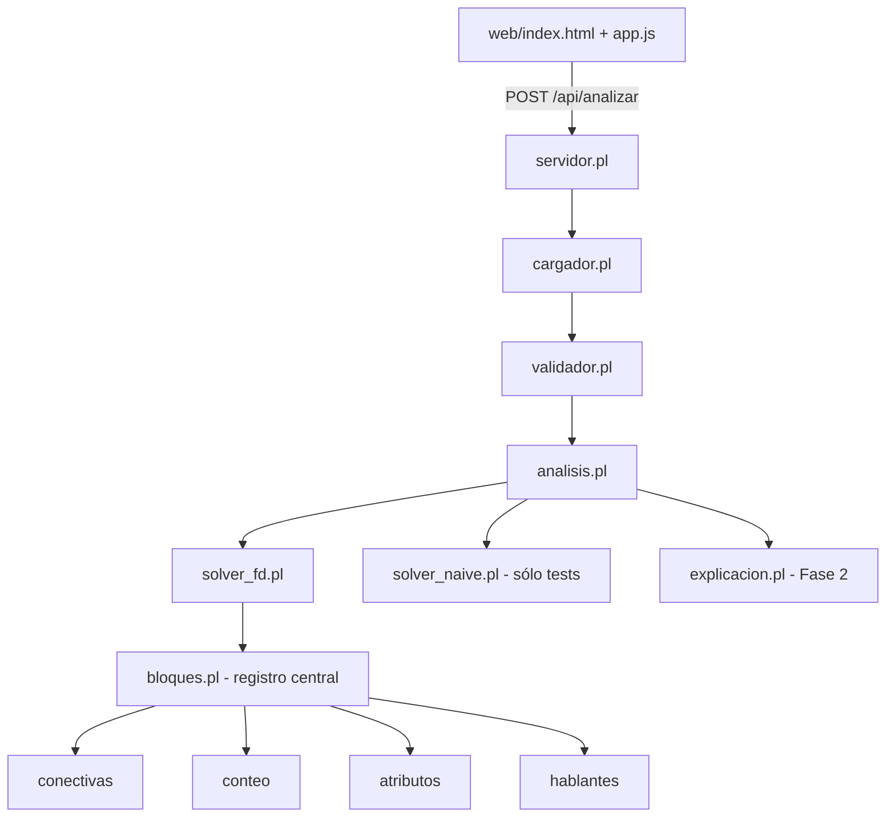

# 01 · Arquitectura

> Estado: implementado; las rutas son las reales del repositorio.

## Módulos y responsabilidades

| Módulo | Responsabilidad | Depende de |
|---|---|---|
| `prolog/main.pl` | Punto de entrada; carga módulos y expone API de alto nivel | todos |
| `prolog/bloques.pl` | Registro central: nombre/aridad, descripción, traducción al solver, regla de explicación | `bloques/*` |
| `prolog/bloques/conectivas.pl` | Traducción de `y/2`, `o/2`, `no/1`, `si/2`, `sii/2`, `xor/2` | `clpfd` |
| `prolog/bloques/conteo.pl` | Traducción de conteo de entidades y de fórmulas | `clpfd` |
| `prolog/bloques/atributos.pl` | Traducción de `es/2`, `igual/3`, `distinto/3`, `vecino/3`, `antes/3`, `todos_distintos/2` | `clpfd` |
| `prolog/bloques/hablantes.pl` | Regla de veracidad por tipo de hablante (`caballero`, `truhan`, `normal`, `alternante`, `ninguno`) | `clpfd` |
| `prolog/cargador.pl` | Lectura con `read_term/3`, lista blanca, expansión segura de macros, módulo aislado | — |
| `prolog/validador.pl` | Errores en español con Id de pista, línea y sugerencia | `bloques` |
| `prolog/solver_fd.pl` | Motor principal: codificación 0/1 + reificación + `labeling/2` | `bloques` |
| `prolog/solver_naive.pl` | Generar-y-probar para validar el motor principal en tests | `bloques` |
| `prolog/analisis.pl` | Existencia, unicidad, irredundancia, minimalidad fuerte, límites de tiempo | `solver_fd` |
| `prolog/explicacion.pl` | Fase 2: traza de deducciones | `bloques` |
| `prolog/servidor.pl` | `library(http/thread_httpd)`, `http_dispatch`, JSON | `analisis`, `cargador` |
| `web/` | Editor, paleta, asistente, panel de errores, galería | — |
| `examples/` | Acertijos `.pl` | — |
| `tests/` | `plunit`, un archivo por módulo | — |

## Flujo de una petición

```
texto .pl (web o archivo)
   → cargador: read_term/3 + lista blanca + macros expandidas
   → validador: errores amigables (Id, línea, sugerencia)
   → solver_fd: modelo CLP(FD) → soluciones (tope configurable)
   → analisis: unicidad / irredundancia / minimalidad
   → JSON → web
```

## Diagrama



## Aislamiento

El código del usuario **nunca se consulta** (`consult/1`) en el proceso principal: se lee término a
término y se interpreta como datos. Las macros se expanden por sustitución de variables contra un
registro de cabezas y cuerpos ya validados. Detalles en `doc/11-seguridad.md`.
